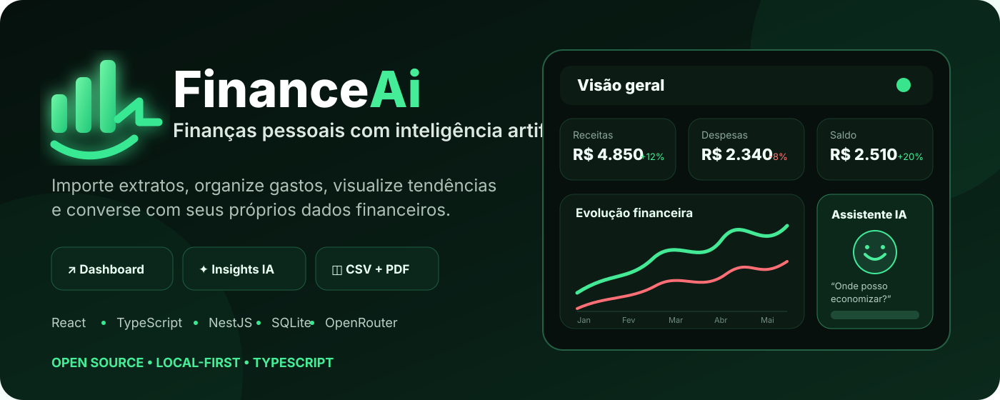

<p align="center">
  
</p>

<div align="center">

# FinanceAi

**Finanças pessoais com dashboard, importação de extratos e recursos de IA.**

Organize transações, acompanhe seus gastos, gere análises e converse com seus próprios dados financeiros em uma aplicação que roda localmente.

[](https://www.typescriptlang.org/)
[](https://react.dev/)
[](https://nestjs.com/)
[](https://www.sqlite.org/)
[](https://openrouter.ai/)

</div>

---

## Sobre o projeto

FinanceAi é uma aplicação de finanças pessoais criada para transformar extratos bancários em uma visão simples e útil da vida financeira.

Os dados são armazenados localmente em SQLite. A aplicação permite importar transações, categorizar gastos com auxílio de IA, visualizar dashboards, gerar insights, prever gastos e conversar com o histórico financeiro por meio de um chat contextual.

> **Privacidade:** os dados ficam persistidos localmente, mas funcionalidades de IA enviam o conteúdo necessário para processamento pela API do OpenRouter. Não use dados sensíveis sem entender e aceitar essa integração.

## Funcionalidades

- Importação de extratos em **CSV** e **PDF**
- Categorização automática de transações com IA
- Edição manual de categorias
- Dashboard com receitas, despesas e distribuição por categoria
- Navegação por período
- Insights automáticos sobre os gastos
- Previsão de gastos do próximo mês
- Chat com contexto das transações
- Banco de dados local com SQLite
- Fallback automático entre modelos de IA
- Testes automatizados no backend

## Stack

| Camada | Tecnologias |
| --- | --- |
| Frontend | React 19, TypeScript, Vite, Tailwind CSS, Framer Motion, Recharts |
| Backend | NestJS, TypeScript, TypeORM |
| Banco | SQLite / better-sqlite3 |
| IA | OpenRouter |
| Testes | Jest |

## Começando

### Pré-requisitos

Você precisa ter instalado:

- **Node.js 20+**
- **npm**
- Uma chave de API do **OpenRouter**

Crie sua chave em: https://openrouter.ai/keys

### Instalação rápida

```bash
git clone https://github.com/Bakeend/FinanceAi.git
cd FinanceAi

cp backend/.env.example backend/.env
```

Abra `backend/.env` e substitua:

```env
OPENROUTER_API_KEY=sk-or-replace-me
```

Depois execute:

```bash
npm run setup
npm run dev
```

A aplicação ficará disponível em:

- Frontend: http://localhost:5173
- Backend: http://localhost:3001

### Windows PowerShell

No PowerShell, você pode criar o arquivo de ambiente com:

```powershell
Copy-Item backend/.env.example backend/.env
```

Depois:

```powershell
npm run setup
npm run dev
```

## Variáveis de ambiente

As configurações do backend ficam em `backend/.env`.

| Variável | Descrição | Padrão |
| --- | --- | --- |
| `OPENROUTER_API_KEY` | Chave utilizada pelos recursos de IA | obrigatório |
| `DATABASE_PATH` | Caminho do banco SQLite | `./data/financeai.db` |
| `PORT` | Porta do backend | `3001` |
| `APP_REFERER` | URL informada ao OpenRouter | `http://localhost:5173` |
| `APP_TITLE` | Nome enviado na identificação da aplicação | `FinanceAi` |

Nunca faça commit do seu arquivo `.env` nem de chaves reais.

## Como usar

1. Abra `http://localhost:5173`.
2. Vá até **Upload** e envie seu extrato.
3. Para CSV, utilize colunas no formato `data,descricao,valor`.
4. Revise as categorias atribuídas automaticamente.
5. Consulte o **Dashboard** para acompanhar os gastos.
6. Use **Insights** para gerar análises e previsões.
7. Abra o **Chat** para fazer perguntas sobre suas transações.

### PDFs

PDFs com texto podem ser processados pela aplicação.

PDFs escaneados apenas como imagem não possuem OCR integrado no momento. Para esses casos, converta o extrato para CSV antes da importação.

## Scripts

Na raiz do projeto:

```bash
npm run setup     # instala dependências e executa as migrations
npm run dev       # inicia backend e frontend juntos
npm run build     # build de produção
npm test          # executa os testes do backend
```

Também é possível executar cada parte separadamente.

### Backend

```bash
cd backend
npm install
npm run migration:run
npm run start:dev
```

### Frontend

```bash
cd frontend
npm install
npm run dev
```

## Testes

Execute:

```bash
npm test
```

A suíte inclui testes relacionados a parsing de extratos, transações, integração com OpenRouter, categorização por IA e serviços do dashboard.

Para cobertura:

```bash
cd backend
npm run test:cov
```

## Estrutura do projeto

```text
FinanceAi/
├── backend/
│   ├── src/
│   │   ├── ai/
│   │   ├── dashboard/
│   │   ├── database/
│   │   └── transactions/
│   ├── test/
│   └── data/
├── frontend/
│   └── src/
│       ├── components/
│       ├── lib/
│       └── pages/
├── docs/
├── package.json
└── README.md
```

## Arquitetura

O FinanceAi é dividido em duas aplicações:

- **Frontend:** interface React responsável pela experiência do usuário e visualização dos dados.
- **Backend:** API NestJS responsável por importação, persistência, cálculos, dashboard e comunicação com os modelos de IA.

O SQLite mantém a instalação simples e não exige a configuração de PostgreSQL, MySQL ou outro servidor de banco de dados.

## OpenRouter e modelos de IA

O projeto utiliza OpenRouter para recursos como categorização, análises, previsão e chat.

A disponibilidade, limites e preços dos modelos podem mudar ao longo do tempo. Por isso, não dependa de uma cota específica descrita no código ou em documentação antiga.

Se um modelo configurado estiver indisponível ou limitado, o backend pode tentar modelos alternativos antes de retornar erro.

## Contribuindo

Contribuições são bem-vindas.

Uma forma simples de contribuir:

1. Faça um fork do projeto.
2. Crie uma branch para sua mudança.

```bash
git checkout -b feat/minha-melhoria
```

3. Faça suas alterações e testes.
4. Crie um commit claro.

```bash
git commit -m "feat: adiciona minha melhoria"
```

5. Envie a branch para o seu fork.
6. Abra um Pull Request explicando o problema e a solução proposta.

Antes de enviar um PR, tente garantir que:

```bash
npm test
npm run build
```

continuem passando.

### Ideias de contribuição

Algumas áreas interessantes para evoluir:

- suporte a novos formatos de extrato
- OCR para PDFs escaneados
- novas visualizações e relatórios
- regras de categorização personalizadas
- exportação de dados
- melhorias de acessibilidade
- mais testes
- suporte a novos provedores/modelos de IA
- documentação e traduções

## Segurança

Encontrou uma vulnerabilidade?

Evite publicar chaves, extratos, informações bancárias ou outros dados pessoais em Issues, Pull Requests ou logs.

Ao reportar um problema, remova qualquer informação sensível antes de compartilhar exemplos.

## Status open source

O projeto está sendo preparado para publicação como open source.

Para que ele seja **oficialmente open source**, ainda é necessário:

- tornar o repositório público;
- adicionar uma licença open source ao repositório.

Atualmente não existe um arquivo `LICENSE`, portanto nenhuma licença de reutilização deve ser presumida.

## Licença

**Ainda não definida.**

Antes da abertura pública do projeto, escolha uma licença adequada, como **MIT**, **Apache-2.0** ou outra compatível com os objetivos do FinanceAi.

---

<div align="center">

Feito por [Bakeend](https://github.com/Bakeend).

Se o FinanceAi for útil para você, considere deixar uma ⭐ no repositório.

</div>
